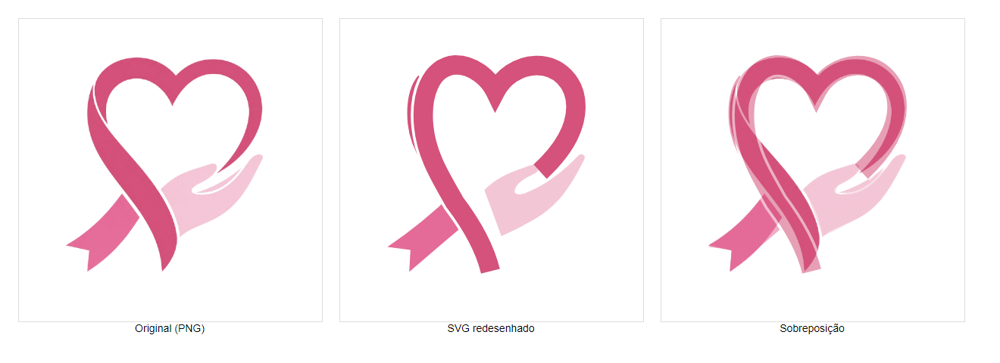
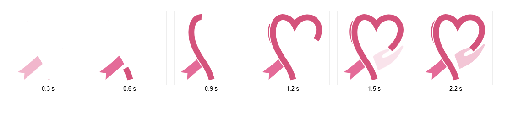
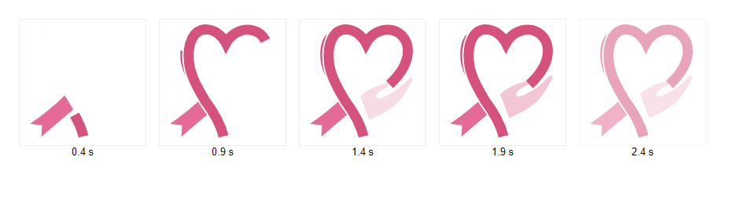

# Logo do RiskCare em SVG (com o laço sendo desenhado)

> Feito em 28/10/2026, na branch `feat/front-home-redesign`. Itens no [CHECKLIST.md](../../CHECKLIST.md): FR-18, FR-19 e FR-25.

## 1. Por que

A logo original existe apenas como imagem PNG ([public/riskcare_logo.png](../../public/riskcare_logo.png)) e não há
arquivo vetorial (confirmado pelo Caio). Uma imagem PNG só pode ser movida, aumentada ou esmaecida; não dá para
"desenhar" o laço. A primeira tentativa foi um batimento suave do PNG, que não agradou: o objetivo é ver o **laço
sendo desenhado**.

Por isso a logo foi **redesenhada em SVG**, à mão, a partir do PNG. Ganhos:

- animação do laço sendo traçado;
- nitidez em qualquer tamanho (cabeçalho, rodapé, favicon, PDF);
- cores controladas por CSS (alto contraste, fundos diferentes).

## 2. Comparação com o original

Da esquerda para a direita: PNG original, SVG redesenhado e os dois sobrepostos. O desenho foi ajustado em quatro
rodadas até coincidir com o original no coração, na dobra do laço, na ponta clara e na mão. **Não é idêntico pixel
a pixel**: as curvas foram simplificadas, e o laço tem espessura constante (no original ela varia levemente).

## 3. Estrutura do SVG

`viewBox="9 9 80 80"`. Camadas, de baixo para cima ([src/components/RiskCareLogo.jsx](../../src/components/RiskCareLogo.jsx)):

| Camada | Classe | Forma | Cor |
|--------|--------|-------|-----|
| Mão | `rc-logo__hand` | forma preenchida | `#f3c6d6` |
| Ponta clara do laço | `rc-logo__tail` | forma preenchida (com o recorte em "V") | `#e46b98` |
| Dobra do laço | `rc-logo__fold` | linha fina (2,2) por fora do lado esquerdo | `#d4527b` |
| Fio de separação | `rc-logo__gap` | o mesmo caminho do laço, mais largo (8,2), na cor do fundo | `--rc-logo-gap` |
| Laço | `rc-logo__ribbon` | **um único caminho** com contorno (6,4), da ponta de baixo até o fim do coração, junto à mão | `#d4527b` |

O "fio de separação" reproduz os filetes brancos do original entre o laço, a ponta clara e a mão. Ele usa a cor do
fundo, definida pela variável `--rc-logo-gap`:

| Onde | `--rc-logo-gap` |
|------|-----------------|
| Padrão (fundo branco, cabeçalho) | `#fff` |
| Rodapé (`.site-footer__logo-mark`) | `var(--rc-surface)` |
| Alto contraste | `#0d0d0d` |

**Ao usar a logo sobre outro fundo, ajuste `--rc-logo-gap`**, senão o fio aparece como um contorno branco.

## 4. Animação

Feita só com CSS ([src/styles/logo.css](../../src/styles/logo.css)), sem biblioteca. Os caminhos do laço e da dobra
usam `pathLength="1"`; a animação leva `stroke-dashoffset` de 1 (invisível) a 0 (completo).

| Momento | O que acontece |
|---------|----------------|
| 0,15 s → 0,6 s | A ponta clara aparece (esmaecimento) |
| 0,25 s → 1,55 s | O laço é **desenhado** da ponta de baixo, sobe pelo lado esquerdo e forma o coração |
| 0,75 s → 1,35 s | A dobra do laço é desenhada |
| 1,3 s → 1,9 s | A mão surge de baixo para cima |

Comportamento:

- **Cabeçalho:** loop lento, sem depender do mouse (classe `rc-logo--loop-slow`): a cada **9 s** o laço é
  redesenhado (cerca de 1,9 s de animação) e, no resto do ciclo, a logo fica completa. O intervalo longo evita
  movimento constante ao lado do conteúdo. (Até 29/10/2026 a animação tocava só ao carregar e ao passar o mouse.)
- **Rodapé:** logo parada (`<RiskCareLogo />` sem `animated`).
- **Tela de carregamento** ([RouteLoadingPage.jsx](../../src/components/RouteLoadingPage.jsx), usada ao verificar o
  acesso, ao carregar a home, no login e no cadastro): logo grande (112 px) em **loop** — desenha, segura um instante,
  esmaece e recomeça a cada 2,6 s (classe `rc-logo--loop`, em [src/styles/loading.css](../../src/styles/loading.css)).
  Substituiu os três pontinhos que pulavam.
- **Abertura do site** ([App.jsx](../../src/App.jsx)): ao abrir o site, a tela de carregamento mostra a logo com
  "Carregando…"; quando o carregamento termina, a logo fica completa e o texto dá lugar ao nome **RiskCare**, que
  surge letra por letra (~1,1 s) antes de o site aparecer. Em produção acontece só na primeira visita da sessão
  (`sessionStorage`); em desenvolvimento acontece sempre, com tempo mínimo de 3,5 s para visualizar (FR-28).

  
- **Acessibilidade:** com `prefers-reduced-motion: reduce` a logo aparece pronta, sem animação. O SVG é decorativo
  (`aria-hidden`) porque o nome "RiskCare" está escrito ao lado; para usar sozinho, passe `title`.

## 5. Arquivos

| Arquivo | Uso |
|---------|-----|
| [src/components/RiskCareLogo.jsx](../../src/components/RiskCareLogo.jsx) | Componente React (props `animated`, `className`, `title`) |
| [src/styles/logo.css](../../src/styles/logo.css) | Cores, fio de separação, animação |
| [src/styles/loading.css](../../src/styles/loading.css) | Tela de carregamento e animação em loop |
| [public/riskcare-logo.svg](../../public/riskcare-logo.svg) | Versão estática com cores fixas, para favicon, PDF e compartilhamento |
| [public/riskcare_logo.png](../../public/riskcare_logo.png) | Original; ainda usado no login, formulário, resultado e favicon (FR-25) |
| [logo/comparacao.png](logo/comparacao.png) e [logo/animacao-quadros.png](logo/animacao-quadros.png) | Registro visual deste trabalho |

## 6. Como ajustar o desenho no futuro

1. Edite os caminhos em `RiskCareLogo.jsx` **e** em `public/riskcare-logo.svg` (mantenha os dois iguais).
2. Gere uma página com o PNG original e o SVG sobrepostos (opacidade ~55%) e compare no navegador, como foi feito
   para a imagem [logo/comparacao.png](logo/comparacao.png).
3. O laço precisa continuar sendo **um único caminho com contorno**; se virar forma preenchida, a animação de desenho
   deixa de funcionar.

## 7. Pendências

- **FR-25:** usar o SVG também no cabeçalho do login, no formulário, no resultado, no favicon e no PDF (a tela de carregamento já usa).
- Se um dia houver um designer, vale refinar a espessura variável do laço; a estrutura e a animação continuam iguais.
